# Pen and Paper Puzzles: Comprehensive Visual Puzzle Guide 📰🧩

Welcome to the comprehensive visual catalog and player guide for **Pen and Paper Puzzles**! This guide illustrates each of the **20 open-source puzzle types** printed directly to your physical 80mm commercial thermal receipt printer.

For each puzzle, you will find:
- **Canonical One-Sentence Gameplay Instruction** (conforming to the $\le 100$-character thermal standard)
- **Core Objective & Rules of Play**
- **Authentic Thermal Board Comparison**: Side-by-side **Starting Position** vs. **Completed Solution**
- **Opening Deduction Anchors**: Proven opening strategies to start solving without guessing
- **Frequently Asked Questions (FAQ)**

---

## 📑 Table of Contents

1. [SUDOKU](#sudoku)
2. [SEARCH *(Word Search)*](#search)
3. [NONOGRAM *(Picross)*](#nonogram)
4. [STARS *(Queens / Star Battle)*](#stars)
5. [JUMBLE](#jumble)
6. [BINARY *(Takuzu / Binairo)*](#binary)
7. [MINES *(Minesweeper Deduction)*](#mines)
8. [TENTS *(Tents & Trees)*](#tents)
9. [BRIDGES *(Hashiwokakero)*](#bridges)
10. [KILLER *(Killer Sudoku)*](#killer)
11. [CRYPTOGRAM](#cryptogram)
12. [TANGO](#tango)
13. [LADDER *(Word Ladder / Doublets)*](#ladder)
14. [WHEEL *(Word Wheel / Target Anagram)*](#wheel)
15. [LIGHTS *(Akari / Light Up)*](#lights)
16. [LOOP *(Slitherlink / Fences)*](#loop)
17. [TOWERS *(Skyscrapers)*](#towers)
18. [INEQUALITY *(Futoshiki)*](#inequality)
19. [MAZE *(Labyrinth)*](#maze)
20. [SUDOKITO *(Mini Sudoku)*](#sudokito)

---

## 1. --- SUDOKU ---
> **Instruction**: `Fill every row, column, and 3x3 box with digits 1-9 without repeating.`

### 🎯 Objective
Complete the 9x9 grid with digits 1 through 9 so that no number is repeated within any horizontal row, vertical column, or outlined 3x3 box.

### 📜 Rules of Play
- Every row must contain digits 1-9 exactly once.
- Every column must contain digits 1-9 exactly once.
- Every 3x3 bold box must contain digits 1-9 exactly once.
- Given clues are permanent and cannot be altered or moved.

### 🖼️ Board Comparison: Starting Position vs. Completed Solution
| Starting Position (Fresh Receipt) | Completed Solution (Solved Grid) |
| :---: | :---: |
| 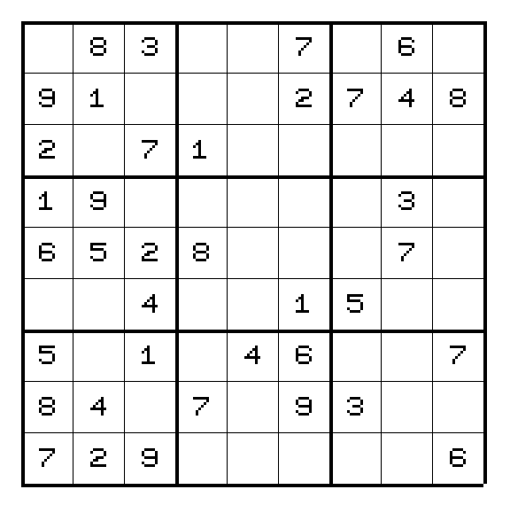 | 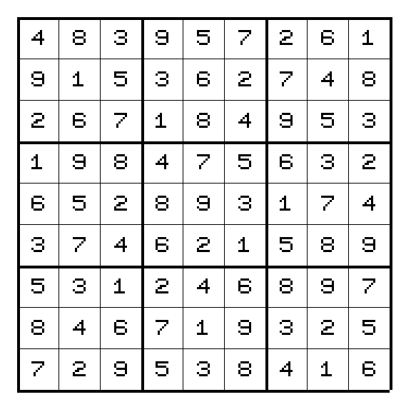 |

### 💡 Opening Deduction Anchors
- Scan rows, columns, and 3x3 boxes that already have 6 or 7 numbers filled; only 2 or 3 candidates remain.
- Use cross-hatching: trace a common digit (like 1 or 7) across perpendicular lines into an empty 3x3 box to eliminate squares.

### ❓ Frequently Asked Questions
* **Q: Do the numbers in a line need to be in numerical order?**
  **A**: No. Digits can appear in any order as long as each number from 1 to 9 appears exactly once.
* **Q: Do arithmetic or mathematical sums matter in classic Sudoku?**
  **A**: No. Sudoku is purely deductive placement. The numbers could just as easily be 9 letters or symbols.

---

## 2. --- SEARCH ---
**Also Known As**: *Word Search*

> **Instruction**: `Find all hidden words horizontally, vertically, or diagonally.`

### 🎯 Objective
Locate every target theme word concealed within the letter grid in straight continuous lines.

### 📜 Rules of Play
- Words are spelled in straight lines: horizontal, vertical, or diagonal.
- Words can run forwards or backwards in any direction.
- Letters may overlap and be shared by multiple intersecting words.
- Lines never bend, turn corners, or zig-zag.

### 🖼️ Board Comparison: Starting Position vs. Completed Solution
| Starting Position (Fresh Receipt) | Completed Solution (Solved Grid) |
| :---: | :---: |
| 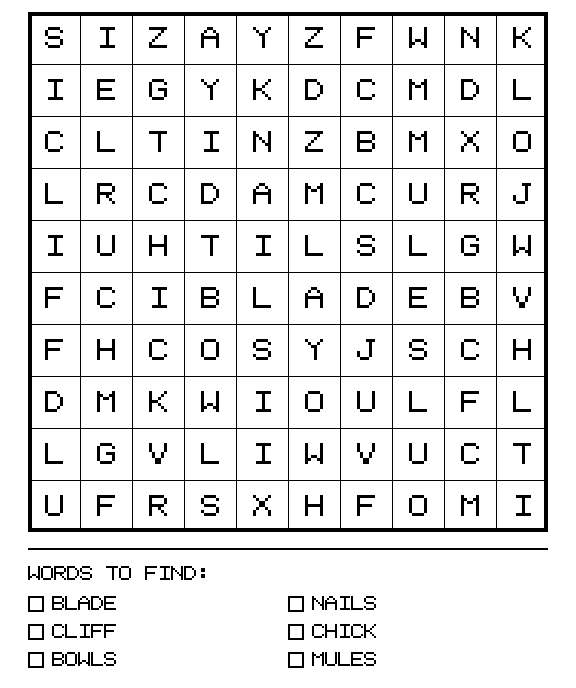 | 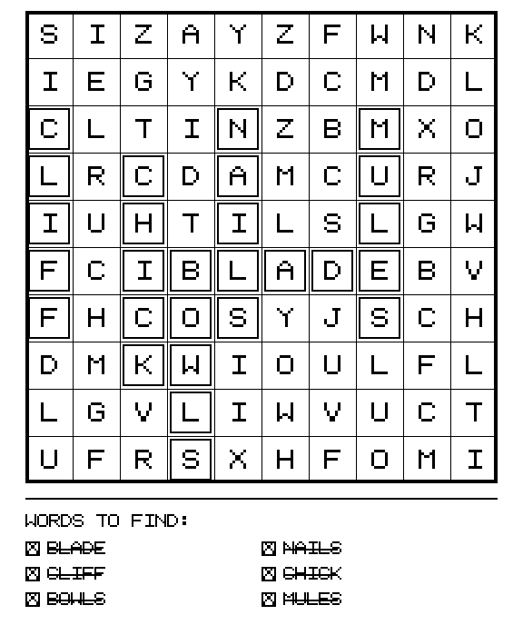 |

### 💡 Opening Deduction Anchors
- Search for rare letters in the word list (like Z, X, Q, or K) first, as they appear rarely in the grid.
- Scan the word list for consecutive double letters (like EE, LL, or OO) and skim the grid for those pairs.

### ❓ Frequently Asked Questions
* **Q: Can words run backwards from right to left or bottom to top?**
  **A**: Yes. Words can be oriented in any of the 8 standard compass directions.
* **Q: Can one letter belong to more than one word?**
  **A**: Yes. Crossing words frequently share an intersecting common letter.

---

## 3. --- NONOGRAM ---
**Also Known As**: *Picross*

> **Instruction**: `Shade cells to match row and column run counts with at least one blank between runs.`

### 🎯 Objective
Deduce which cells to shade black so that consecutive shaded runs match every outer row and column clue.

### 📜 Rules of Play
- Numbers outside the grid indicate the lengths of consecutive shaded blocks in that line.
- Multiple numbers mean multiple shaded blocks in that exact sequential order.
- Every pair of distinct shaded blocks must be separated by at least one empty white cell.
- Lines with a 0 or empty clue contain zero shaded cells.

### 🖼️ Board Comparison: Starting Position vs. Completed Solution
| Starting Position (Fresh Receipt) | Completed Solution (Solved Grid) |
| :---: | :---: |
| 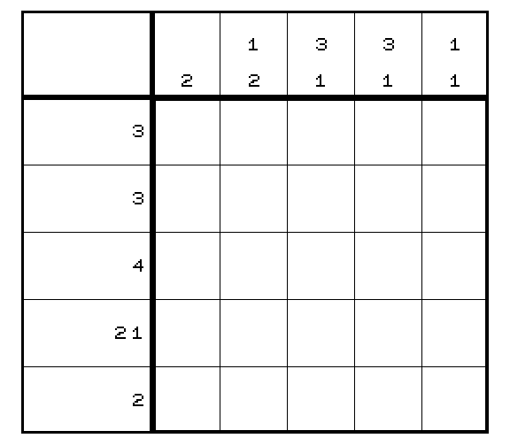 | 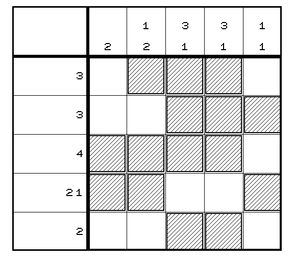 |

### 💡 Opening Deduction Anchors
- Look for full-line clues: if a line clue equals the grid width, shade the entire line immediately.
- Use clue overlap: when a clue number is greater than half the grid width, the middle cells must always be shaded regardless of alignment.

### ❓ Frequently Asked Questions
* **Q: Must there be an empty space between two shaded blocks?**
  **A**: Yes. Separate numbers in a clue always require at least one blank cell between their blocks.
* **Q: Do the clues specify the order of the blocks?**
  **A**: Yes. Row clues read left-to-right; column clues read top-to-bottom.

---

## 4. --- STARS ---
**Also Known As**: *Queens / Star Battle*

> **Instruction**: `Place stars in every row, column, and outlined region without touching, even diagonally.`

### 🎯 Objective
Position stars on the board so that every row, column, and outlined region has the required star count with no adjacent stars.

### 📜 Rules of Play
- Every row and column must contain exactly the target star quota (1 or 2 stars).
- Every outlined geometric region must contain exactly the target star quota.
- No two stars may touch each other anywhere—not orthogonally, and not diagonally.
- Every placed star creates an 8-cell empty buffer zone surrounding it.

### 🖼️ Board Comparison: Starting Position vs. Completed Solution
| Starting Position (Fresh Receipt) | Completed Solution (Solved Grid) |
| :---: | :---: |
| 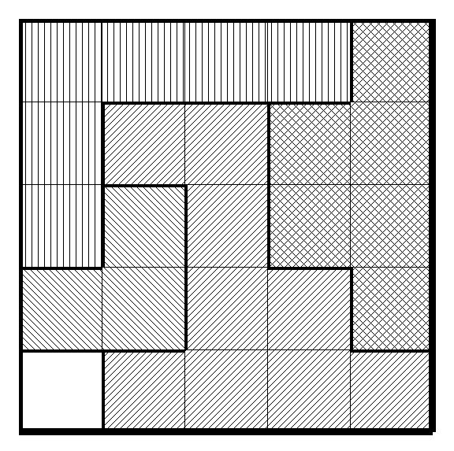 | 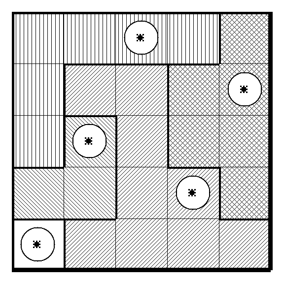 |

### 💡 Opening Deduction Anchors
- Find anchor regions with only 1 or 2 total cells. A 1-cell region requiring 1 star must immediately hold a star!
- Whenever a star is placed, immediately dot all 8 surrounding cells—none of them can ever hold a star.

### ❓ Frequently Asked Questions
* **Q: Can two stars be in the same row if they belong to different regions?**
  **A**: No. The row quota is strict; every row across the entire board has the exact same limit.
* **Q: Does 'not touching diagonally' apply across the whole board?**
  **A**: No. It applies only to immediate neighboring squares that share a corner point.

---

## 5. --- JUMBLE ---
> **Instruction**: `Unscramble each clue word, then use the circled letters to solve the final pun.`

### 🎯 Objective
Unscramble each anagram word into its letter boxes, collect the circled letters, and arrange them to answer the pun riddle.

### 📜 Rules of Play
- Each jumbled word unscrambles into a single valid English word matching the box count.
- Circled letter boxes highlight specific letters needed for the bonus pun.
- The collected circled letters form an anagram pool for the punchline answer.
- Letter blanks and punctuation in the final punchline guide word boundaries.

### 🖼️ Board Comparison: Starting Position vs. Completed Solution
| Starting Position (Fresh Receipt) | Completed Solution (Solved Grid) |
| :---: | :---: |
| 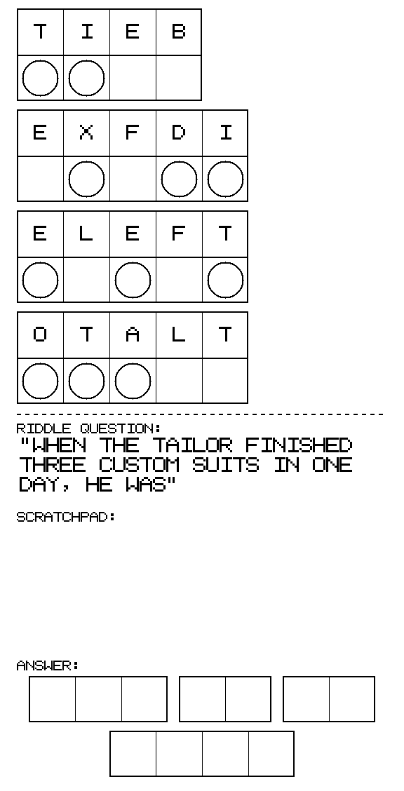 | 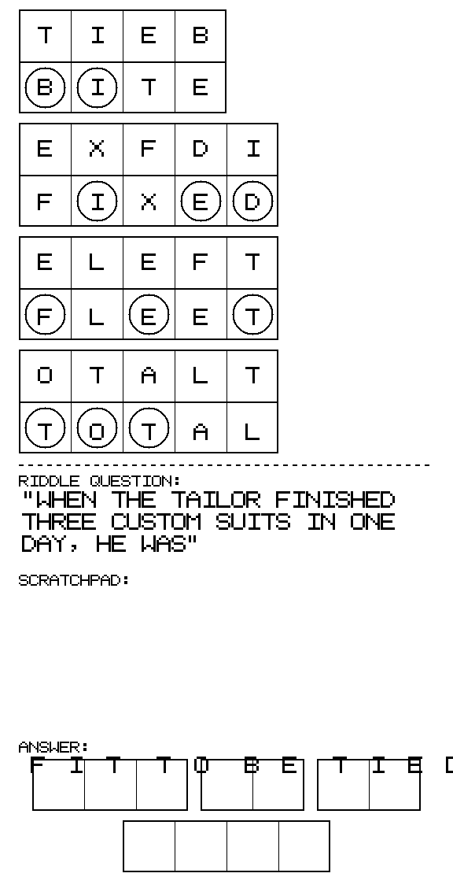 |

### 💡 Opening Deduction Anchors
- Unscramble the shortest clue words first to quickly secure your first circled mystery letters.
- Read the punchline riddle carefully; humor and puns usually reveal the theme of the bonus answer.

### ❓ Frequently Asked Questions
* **Q: Are the circled letters in order when copied to the final answer?**
  **A**: No. The circled letters form an anagram pool and must be unscrambled to solve the pun.
* **Q: What if an anagram word has multiple valid English solutions?**
  **A**: Only one solution will yield the exact letters needed to solve the final riddle pun.

---

## 6. --- BINARY ---
**Also Known As**: *Takuzu / Binairo*

> **Instruction**: `Fill every cell with 0 or 1 so no more than two identical numbers are adjacent.`

### 🎯 Objective
Fill the entire grid with 0s and 1s adhering to adjacency, equal balance, and line uniqueness rules.

### 📜 Rules of Play
- No more than two identical numbers may be placed side-by-side (no '000' or '111').
- Every row and column must contain an equal number of 0s and 1s.
- No two rows may be identical, and no two columns may be identical.
- All given numbers are fixed and permanent.

### 🖼️ Board Comparison: Starting Position vs. Completed Solution
| Starting Position (Fresh Receipt) | Completed Solution (Solved Grid) |
| :---: | :---: |
| 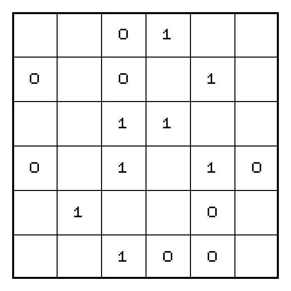 | 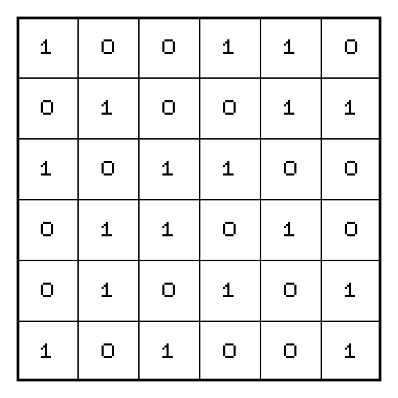 |

### 💡 Opening Deduction Anchors
- Look for pairs: whenever you see two identical digits ('00' or '11'), the cells on both ends must be the opposite digit.
- Look for sandwiches: whenever two identical digits are separated by one blank ('0_0' or '1_1'), the middle cell must be the opposite.

### ❓ Frequently Asked Questions
* **Q: Can diagonal lines have three identical digits?**
  **A**: Yes. The 'no three in a row' rule applies strictly to horizontal rows and vertical columns.
* **Q: What does equal balance mean?**
  **A**: On an 8x8 board, every single row and column must contain exactly four 0s and four 1s.

---

## 7. --- MINES ---
**Also Known As**: *Minesweeper Deduction*

> **Instruction**: `Deduce all hidden mines using numbers showing how many adjacent cells contain mines.`

### 🎯 Objective
Deduce the exact locations of all hidden mines without guessing, using numeric neighbor hints.

### 📜 Rules of Play
- A number in a cell indicates how many of its 8 surrounding neighbors contain a mine.
- Empty unnumbered cells are safe playable territory.
- Mark confirmed mines with a flag or star.
- Every puzzle is logically solvable from given clues with zero guesswork.

### 🖼️ Board Comparison: Starting Position vs. Completed Solution
| Starting Position (Fresh Receipt) | Completed Solution (Solved Grid) |
| :---: | :---: |
| 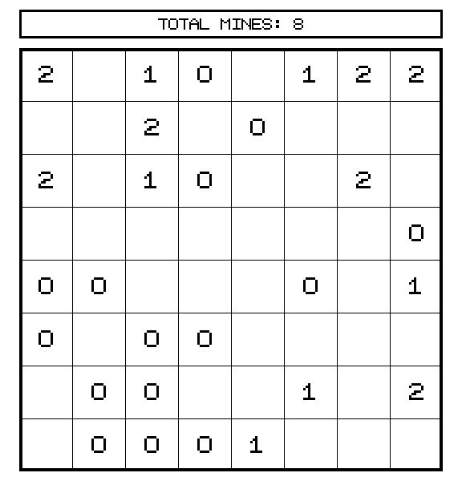 | 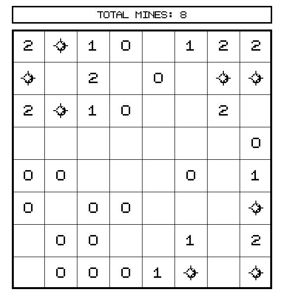 |

### 💡 Opening Deduction Anchors
- Zero clues ('0') are instant safe zones: all 8 surrounding neighbor cells are completely mine-free.
- Corner clues: a '1' in a corner cell with only one hidden neighbor must have the mine in that single neighbor.

### ❓ Frequently Asked Questions
* **Q: Do diagonal cells count toward a number clue?**
  **A**: Yes. Clue numbers count all 8 neighboring cells (orthogonal and diagonal).
* **Q: Can a numbered cell contain a mine?**
  **A**: No. Numbered cells are always safe revealed territory; mines are hidden in blank cells.

---

## 8. --- TENTS ---
**Also Known As**: *Tents & Trees*

> **Instruction**: `Pitch tents beside trees; no tents may touch even diagonally, matching row/column quotas.`

### 🎯 Objective
Pitch a tent for every tree on the board such that tents pair 1:1 orthogonally and never touch each other.

### 📜 Rules of Play
- Every tree must have exactly one tent pitched orthogonally adjacent to it (up, down, left, right).
- Tents can never touch another tent—neither orthogonally nor diagonally.
- Numbers outside the grid specify the exact count of tents in that row or column.
- Tents may be adjacent to trees other than their own assigned partner.

### 🖼️ Board Comparison: Starting Position vs. Completed Solution
| Starting Position (Fresh Receipt) | Completed Solution (Solved Grid) |
| :---: | :---: |
| 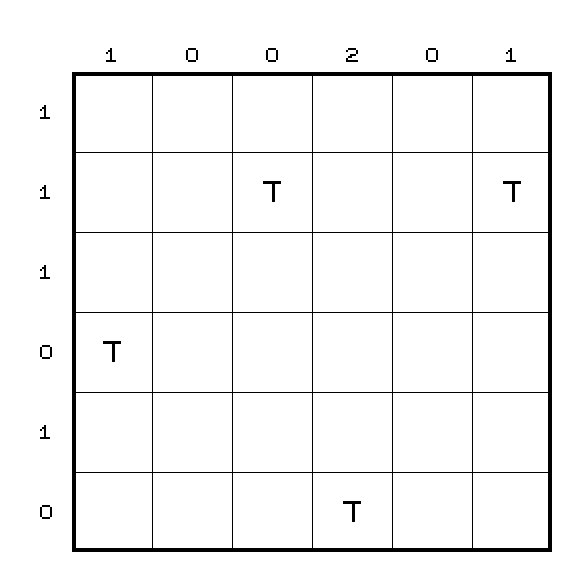 | 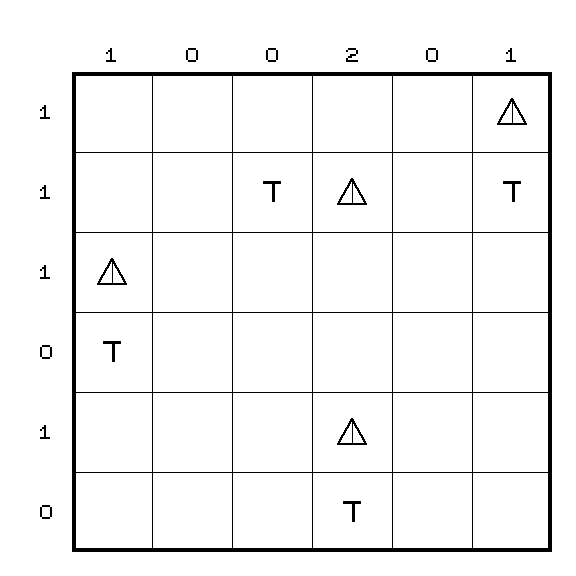 |

### 💡 Opening Deduction Anchors
- Check rows and columns with a clue of '0': immediately eliminate and cross out all cells in that line.
- Trees with only one available empty orthogonal neighbor must pitch their tent into that single spot.

### ❓ Frequently Asked Questions
* **Q: Can a tent be attached diagonally to its tree?**
  **A**: No. A tent must connect to its tree orthogonally (sharing a flat side, not a corner).
* **Q: Can a tent touch a tree that belongs to another tent?**
  **A**: Yes. Tents can touch other trees, but tents can NEVER touch another tent.

---

## 9. --- BRIDGES ---
**Also Known As**: *Hashiwokakero*

> **Instruction**: `Connect islands with up to two orthogonal bridges matching numbers into one network.`

### 🎯 Objective
Connect all numbered islands together into a single continuous interconnected network using horizontal and vertical bridges.

### 📜 Rules of Play
- Bridges run horizontally or vertically between islands, never crossing each other or islands.
- At most two bridges can connect any single pair of islands.
- The number on an island equals the total count of bridges connected to it.
- All islands must form one single connected network when complete.

### 🖼️ Board Comparison: Starting Position vs. Completed Solution
| Starting Position (Fresh Receipt) | Completed Solution (Solved Grid) |
| :---: | :---: |
| 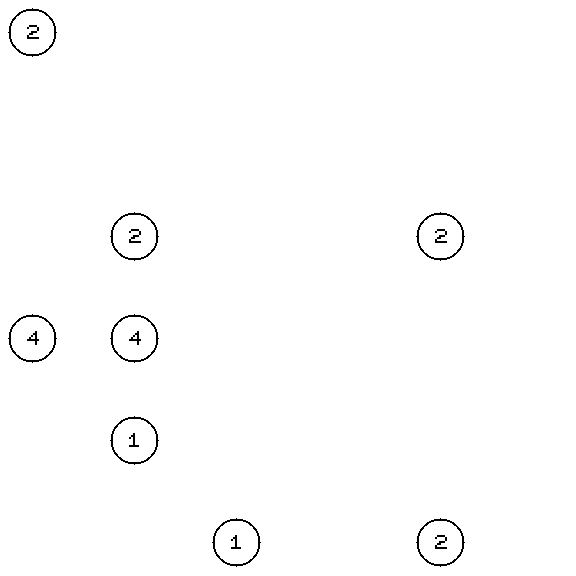 | 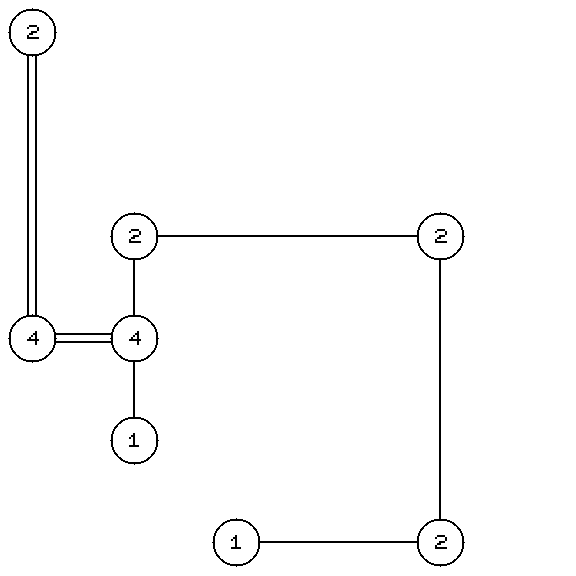 |

### 💡 Opening Deduction Anchors
- Look for high-value corner islands: a corner island marked '4' with only 2 directions available must send 2 bridges each way.
- An island marked '1' that only has one possible neighbor must immediately connect its single bridge.

### ❓ Frequently Asked Questions
* **Q: Can bridges be drawn diagonally?**
  **A**: No. Bridges must run strictly horizontal or vertical.
* **Q: Can the completed puzzle have isolated subnetworks?**
  **A**: No. All islands must link together into a single unified continuous group.

---

## 10. --- KILLER ---
**Also Known As**: *Killer Sudoku*

> **Instruction**: `Fill the grid with digits so cages sum to their clue without repeating digits.`

### 🎯 Objective
Solve the Sudoku grid while satisfying all dotted cage boundary sums with non-repeating digits.

### 📜 Rules of Play
- Standard Sudoku rules apply: digits 1-9 once per row, column, and 3x3 block.
- Dashed outline cages display a target sum in their upper-left corner.
- Digits inside a cage must add up exactly to the cage's clue sum.
- Digits can never repeat within the same cage.

### 🖼️ Board Comparison: Starting Position vs. Completed Solution
| Starting Position (Fresh Receipt) | Completed Solution (Solved Grid) |
| :---: | :---: |
| 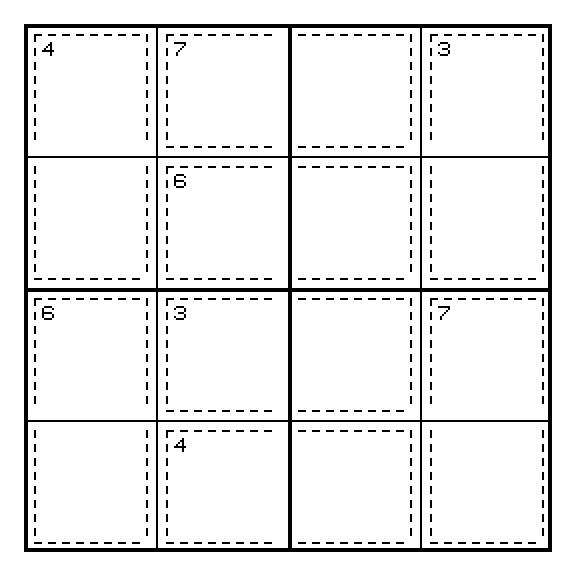 | 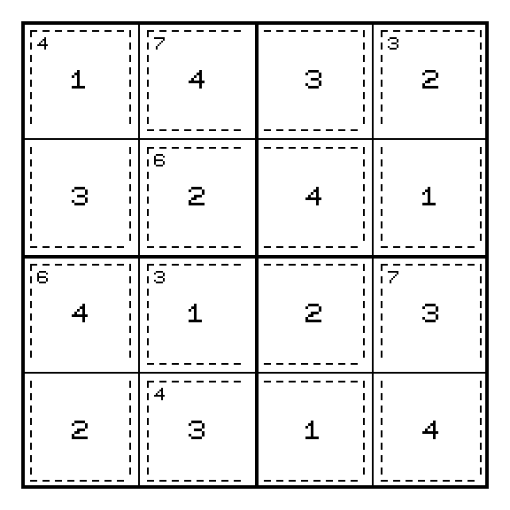 |

### 💡 Opening Deduction Anchors
- Look for unique sum combinations: a 2-cell sum of 3 must be [1, 2]; a 2-cell sum of 4 must be [1, 3]; a 2-cell sum of 17 must be [8, 9].
- Use the Rule of 45: every row, column, and 3x3 block always sums up to exactly 45.

### ❓ Frequently Asked Questions
* **Q: Can a digit repeat in a cage if it spans across different 3x3 boxes?**
  **A**: No. Digits can NEVER repeat within any cage, regardless of boundaries.
* **Q: Are starting clues printed as regular Sudoku numbers?**
  **A**: Usually Killer Sudoku boards begin completely empty, relying entirely on cage sums.

---

## 11. --- CRYPTOGRAM ---
> **Instruction**: `Deduce the hidden quotation where each letter is consistently substituted with another.`

### 🎯 Objective
Decode the secret cipher quotation by discovering which letter replaces each ciphertext letter throughout the puzzle.

### 📜 Rules of Play
- Each ciphertext letter represents one unique substitute plaintext letter throughout the entire puzzle.
- Punctuation, apostrophes, and word spacing remain unchanged and preserved.
- No letter substitutes for itself.
- Once a substitution is determined, it applies to every occurrence of that letter.

### 🖼️ Board Comparison: Starting Position vs. Completed Solution
| Starting Position (Fresh Receipt) | Completed Solution (Solved Grid) |
| :---: | :---: |
| 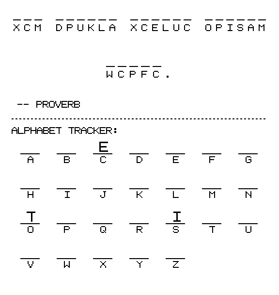 | 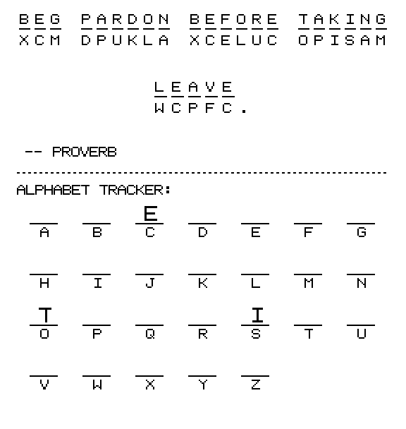 |

### 💡 Opening Deduction Anchors
- Identify single-letter words: in English, single-letter words are almost always 'A' or 'I'.
- Look for common short words like 'THE', 'AND', 'THAT', and letters following apostrophes ('T, 'S, 'LL).

### ❓ Frequently Asked Questions
* **Q: Can a ciphertext letter stand for itself?**
  **A**: No. In standard cryptograms, a letter never encodes to itself.
* **Q: What is the most common letter in English text?**
  **A**: The letter 'E' is by far the most frequent, followed by 'T', 'A', 'O', and 'I'.

---

## 12. --- TANGO ---
> **Instruction**: `Fill grid with 0s and 1s so equal symbols match and opposite symbols differ.`

### 🎯 Objective
Place 0s and 1s so that no three identical symbols touch, lines balance, and relational cues are satisfied.

### 📜 Rules of Play
- No more than two identical symbols may be adjacent horizontally or vertically.
- Each row and column must contain an equal number of 0s and 1s.
- Cells separated by '=' must contain the exact same symbol.
- Cells separated by 'x' must contain opposite symbols.

### 🖼️ Board Comparison: Starting Position vs. Completed Solution
| Starting Position (Fresh Receipt) | Completed Solution (Solved Grid) |
| :---: | :---: |
| 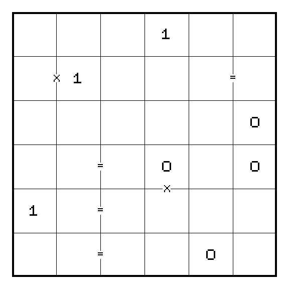 | 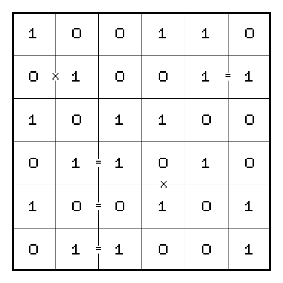 |

### 💡 Opening Deduction Anchors
- Satisfy 'x' (opposite) clues: if one cell is given, the adjacent cell is immediately known.
- Watch for symbol pairs: two adjacent suns ('☀️☀️') must be flanked on both sides by moons ('🌙').

### ❓ Frequently Asked Questions
* **Q: What does the 'x' mark between cells mean?**
  **A**: It means the two cells must have opposite symbols (one sun and one moon).
* **Q: Does the two-in-a-row limit apply diagonally?**
  **A**: No. The adjacency restriction applies strictly to horizontal and vertical lines.

---

## 13. --- LADDER ---
**Also Known As**: *Word Ladder / Doublets*

> **Instruction**: `Deduce words changing one letter at a time to transform start word into end word.`

### 🎯 Objective
Navigate from the top start word to the bottom target word in sequential steps, changing exactly one letter at each rung.

### 📜 Rules of Play
- Each rung of the ladder must form a valid, recognized English word.
- You may change exactly one letter from the previous word at each step.
- Letter positions cannot be anagrammed, rearranged, or swapped.
- The ladder is complete when you reach the target word in the allotted rungs.

### 🖼️ Board Comparison: Starting Position vs. Completed Solution
| Starting Position (Fresh Receipt) | Completed Solution (Solved Grid) |
| :---: | :---: |
| 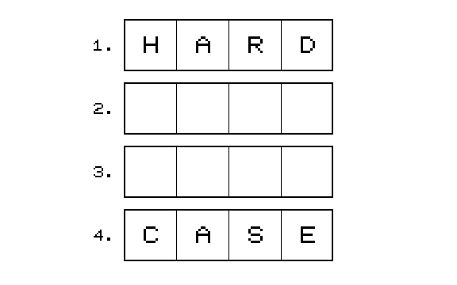 | 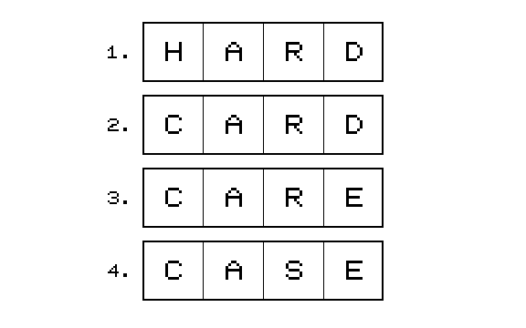 |

### 💡 Opening Deduction Anchors
- Compare the start and target words to count how many letters they already share in identical positions.
- Work bidirectionally: if stuck moving downward from the start, try working upward from the target word.

### ❓ Frequently Asked Questions
* **Q: Can I rearrange the letters while changing one?**
  **A**: No. All unchanged letters must remain in their exact same positions.
* **Q: Are proper nouns like names allowed as intermediate words?**
  **A**: No. Every step must be a standard dictionary English word.

---

## 14. --- WHEEL ---
**Also Known As**: *Word Wheel / Target Anagram*

> **Instruction**: `Find words of 4+ letters using the wheel letters, always including the center letter.`

### 🎯 Objective
Form as many valid English words of 4 or more letters as possible from the circular letter wheel.

### 📜 Rules of Play
- Every word must be at least 4 letters long.
- Every word must contain the designated central hub letter.
- Letters can only be used as many times as they appear in the wheel.
- At least one 9-letter pangram exists that uses every single letter in the wheel.

### 🖼️ Board Comparison: Starting Position vs. Completed Solution
| Starting Position (Fresh Receipt) | Completed Solution (Solved Grid) |
| :---: | :---: |
| 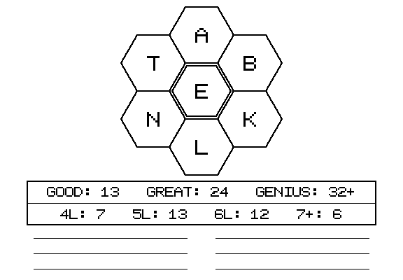 | 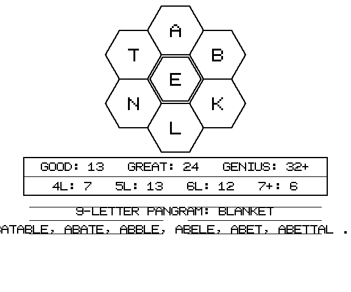 |

### 💡 Opening Deduction Anchors
- Look for common prefixes (like RE-, UN-, DE-) and suffixes (like -ING, -ED, -TION) among the rim letters.
- Keep hunting for the 9-letter master word that utilizes every letter on the wheel.

### ❓ Frequently Asked Questions
* **Q: Can I use letters more than once in a single word?**
  **A**: Only if that letter appears multiple times on the wheel rim.
* **Q: Do words without the center letter count?**
  **A**: No. Any word that omits the central hub letter is strictly invalid.

---

## 15. --- LIGHTS ---
**Also Known As**: *Akari / Light Up*

> **Instruction**: `Place bulbs to light corridors without facing each other; numbers show how many bulbs share an edge.`

### 🎯 Objective
Place lightbulbs in corridors so every white cell is illuminated without any two bulbs facing each other.

### 📜 Rules of Play
- Bulbs emit beams of light horizontally and vertically along corridors until blocked by black barrier blocks.
- Every white grid square must be illuminated by at least one lightbulb.
- No two lightbulbs can illuminate or shine upon each other (no shared line of sight).
- Numbers on black blocks specify how many bulbs must share an edge with that block (horizontally or vertically, not diagonally).

### 🖼️ Board Comparison: Starting Position vs. Completed Solution
| Starting Position (Fresh Receipt) | Completed Solution (Solved Grid) |
| :---: | :---: |
| 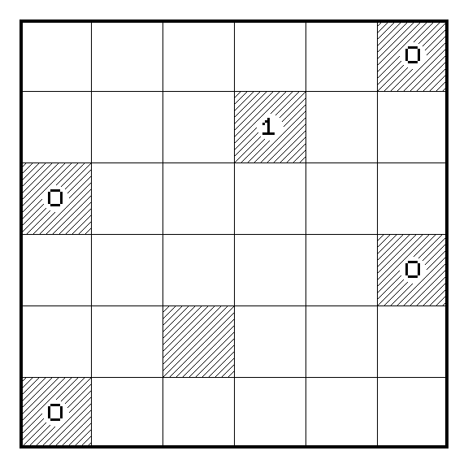 | 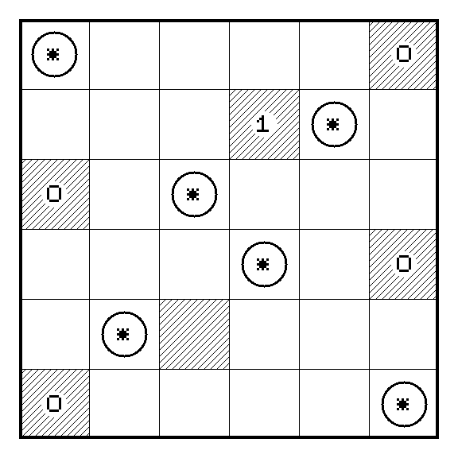 |

### 💡 Opening Deduction Anchors
- Locate '0' barrier blocks: place small dots or crosses on all 4 adjacent cells; no bulbs can go there.
- Locate '4' barrier blocks (or corner '2's): all available orthogonal spaces around them must immediately hold bulbs.

### ❓ Frequently Asked Questions
* **Q: Can light beams shine diagonally?**
  **A**: No. Light travels strictly in orthogonal horizontal and vertical straight lines.
* **Q: Can light pass through black barrier blocks?**
  **A**: No. Black blocks completely obstruct and stop light beams.

---

## 16. --- LOOP ---
**Also Known As**: *Slitherlink / Fences*

> **Instruction**: `Draw a single continuous closed loop around numbers indicating surrounding line count.`

### 🎯 Objective
Connect dots with horizontal and vertical line segments to form one continuous closed loop that never branches or crosses.

### 📜 Rules of Play
- A number inside a cell specifies exactly how many of its 4 boundary edges belong to the loop.
- Cells with no number may have any count of boundary edges (0, 1, 2, or 3).
- The loop must form a single continuous closed circuit.
- The loop can never branch, fork, intersect, or cross itself.

### 🖼️ Board Comparison: Starting Position vs. Completed Solution
| Starting Position (Fresh Receipt) | Completed Solution (Solved Grid) |
| :---: | :---: |
| 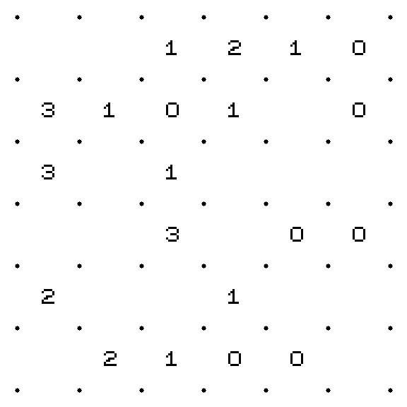 | 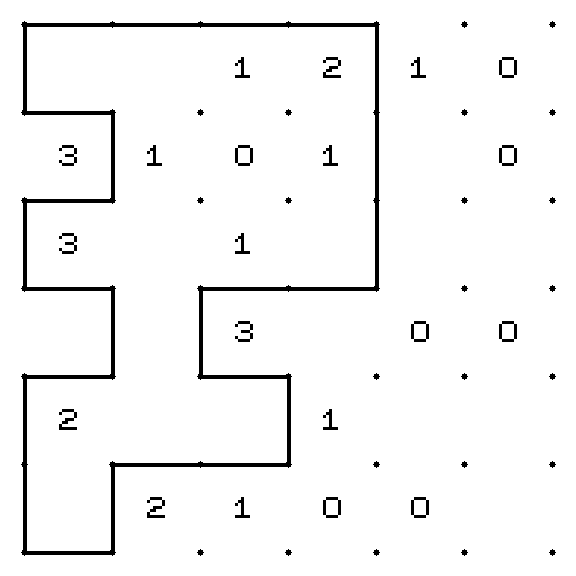 |

### 💡 Opening Deduction Anchors
- Clue '0' is an absolute barrier: cross out all four edges around every 0 cell immediately.
- Adjacent '3' clues: two neighboring 3s always share an outer line pattern and have their common divider filled.

### ❓ Frequently Asked Questions
* **Q: Can there be multiple small loops on the board?**
  **A**: No. There must be exactly one single closed loop incorporating all satisfied clues.
* **Q: Can the loop line connect dots diagonally?**
  **A**: No. Lines run strictly horizontally or vertically between adjacent grid dots.

---

## 17. --- TOWERS ---
**Also Known As**: *Skyscrapers*

> **Instruction**: `Place building heights so edge clues match how many towers are visible in that line.`

### 🎯 Objective
Fill each row and column with skyscrapers of heights 1 to N such that outside clues match visible towers from that vantage point.

### 📜 Rules of Play
- Every row and column must contain building heights 1 through N with no duplicates.
- Numbers outside the grid indicate how many buildings can be seen looking into that line.
- Taller buildings conceal and hide any shorter buildings situated behind them.
- All given starting numbers and edge clues are fixed.

### 🖼️ Board Comparison: Starting Position vs. Completed Solution
| Starting Position (Fresh Receipt) | Completed Solution (Solved Grid) |
| :---: | :---: |
| 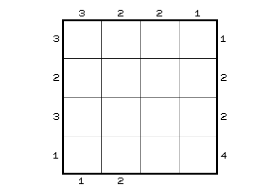 | 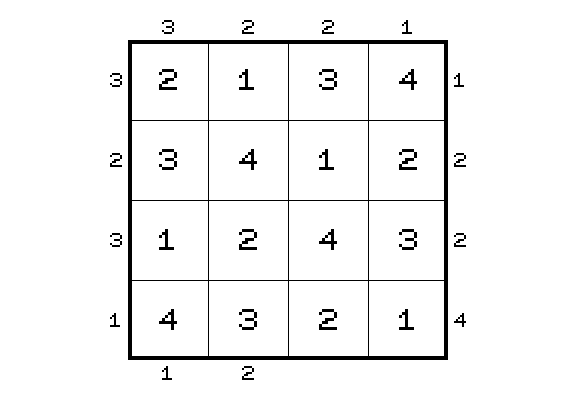 |

### 💡 Opening Deduction Anchors
- Clues of '1': the very first building in that line must be the maximum height (e.g., 5).
- Clues of '5' (on a 5x5): the buildings in that line must ascend in strict sequential order: 1, 2, 3, 4, 5.

### ❓ Frequently Asked Questions
* **Q: Does a taller building hide buildings that are further down the line?**
  **A**: Yes. Any building shorter than a preceding building in the line of sight is hidden.
* **Q: Can heights repeat in a row or column?**
  **A**: No. Each row and column forms a Latin square where each height appears exactly once.

---

## 18. --- INEQUALITY ---
**Also Known As**: *Futoshiki*

> **Instruction**: `Fill grid with digits so each digit appears once per line and inequality signs hold.`

### 🎯 Objective
Fill the grid with numbers 1 to N so no digit repeats in any row or column and all '<' and '>' signs are honored.

### 📜 Rules of Play
- Each row and column must contain digits 1 through N exactly once.
- Inequality signs ('<' and '>') between adjacent cells must be strictly honored.
- The open end of the sign always points to the larger number.
- Initial starting digits and inequality signs cannot be changed.

### 🖼️ Board Comparison: Starting Position vs. Completed Solution
| Starting Position (Fresh Receipt) | Completed Solution (Solved Grid) |
| :---: | :---: |
| 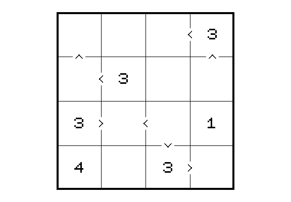 | 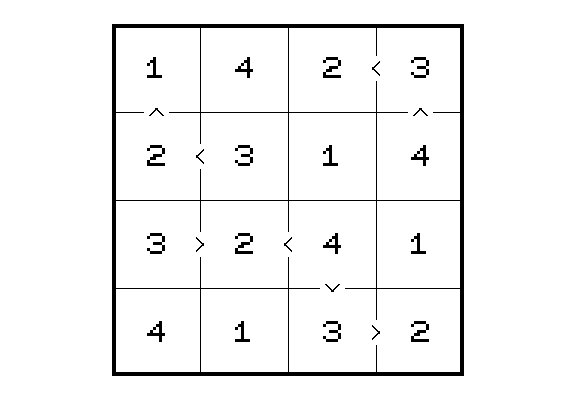 |

### 💡 Opening Deduction Anchors
- Look for chains of inequality signs: a chain of A < B < C < D on a 5x5 grid heavily restricts the possible values.
- The cell at the largest end of multiple inequality signs can never be 1; the smallest end can never be N.

### ❓ Frequently Asked Questions
* **Q: Do inequality signs apply to non-adjacent cells?**
  **A**: No. They apply strictly to the two adjacent squares directly bordering the sign.
* **Q: Can digits repeat in the same row if they satisfy the inequality?**
  **A**: No. Every digit must be unique within its row and within its column.

---

## 19. --- MAZE ---
**Also Known As**: *Labyrinth*

> **Instruction**: `Draw a path from the entrance to the exit without crossing any walls.`

### 🎯 Objective
Navigate from the entrance opening at the top-left to the exit opening at the bottom-right by finding the single continuous path without passing through any solid walls.

### 📜 Rules of Play
- Start at the IN opening on the top-left of the maze.
- Follow open passageways to reach the OUT opening on the bottom-right.
- You cannot cross through or jump over black wall lines.
- Avoid dead ends that lead to closed corridors.

### 🖼️ Board Comparison: Starting Position vs. Completed Solution
| Starting Position (Fresh Receipt) | Completed Solution (Solved Grid) |
| :---: | :---: |
| 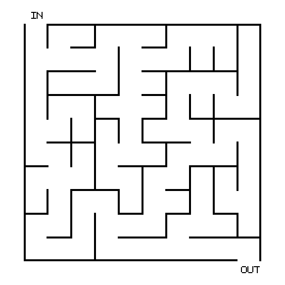 | 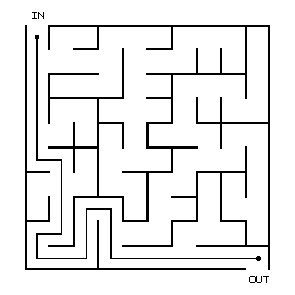 |

### 💡 Opening Deduction Anchors
- Trace backwards from the exit (OUT) towards the start (IN); dead-end false trails often branch forward and are easier to spot in reverse.
- Look for corridor bottlenecks: narrow single passages that must be traversed to transition between quadrants.

### ❓ Frequently Asked Questions
* **Q: Is there always a unique solution path through the maze?**
  **A**: Yes. Every procedural maze contains exactly one continuous open route connecting the entrance to the exit.
* **Q: Do I ever need to retrace or loop back?**
  **A**: No. The true solution path is a direct acyclic route without circular loops or backtracking.

---

## 20. --- SUDOKITO ---
**Also Known As**: *Mini Sudoku*

> **Instruction**: `Fill every row, column, and 2x3 box with digits 1-6 without repeating.`

### 🎯 Objective
Complete the 6x6 grid with digits 1 through 6 so that no number is repeated within any horizontal row, vertical column, or outlined 2x3 box.

### 📜 Rules of Play
- Every row must contain digits 1-6 exactly once.
- Every column must contain digits 1-6 exactly once.
- Every 2x3 bold box must contain digits 1-6 exactly once.
- Given clues are permanent and cannot be altered or moved.

### 🖼️ Board Comparison: Starting Position vs. Completed Solution
| Starting Position (Fresh Receipt) | Completed Solution (Solved Grid) |
| :---: | :---: |
| 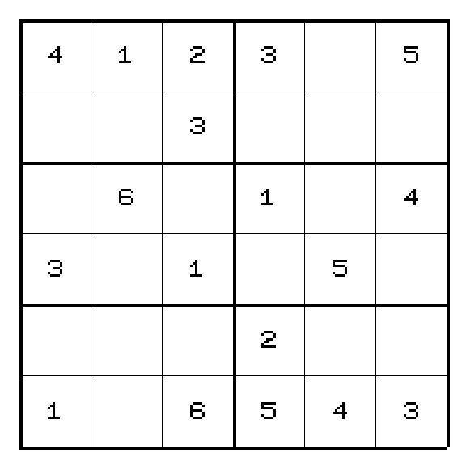 | 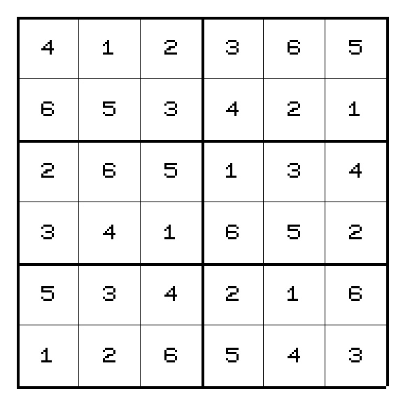 |

### 💡 Opening Deduction Anchors
- Scan 2x3 boxes that already contain 4 or 5 given numbers; only 1 or 2 candidate digits remain.
- Use cross-hatching: trace a known digit across adjacent boxes and rows to pinpoint its only valid location in an unfilled 2x3 region.

### ❓ Frequently Asked Questions
* **Q: How does Sudokito differ from classic Sudoku?**
  **A**: Sudokito uses a smaller 6x6 grid with digits 1-6 and six 2x3 rectangular regions instead of 9x9 with 3x3 squares, offering faster, punchy gameplay.
* **Q: Does every Sudokito puzzle have a guaranteed unique solution?**
  **A**: Yes. Each generated puzzle is verified by a uniqueness solver to ensure exactly one logical solution exists without guessing.

---
